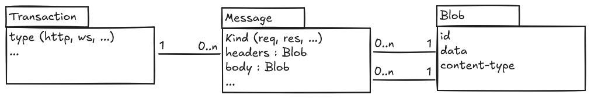

Storage
=======

Storage implementations are in charge of persisting transactions and messages into a backend (database, memory, ...)
using eventual dependencies.

Each storages should implement the :class:`Storage <harp_apps.storage.types.storage.IStorage>` protocol.

Model
:::::

* a :class:`Transaction <harp.models.Transaction>` represents a transaction that went through the
  proxy. A set of request-response forms a transaction in the case of an HTTP transaction (although the response may
  not be present in case of an in progress transaction or a timed out transaction).
* a :class:`Message <harp.models.Message>` represents an atomic message that went through the proxy. An
  http request or response is a message.
* a :class:`Blob <harp.models.Blob>` represents a binary content, for example the headers or the body of
  an http request or response.

Protocol
::::::::

.. autoclass:: harp_apps.storage.types.storage.IStorage
    :members:

Migrations: one branch per application
::::::::::::::::::::::::::::::::::::::

HARP has one alembic environment and one ``alembic_version`` table. Each application that owns tables owns a *branch*
of that history (see ``docs/adr/0012-each-app-owns-an-alembic-branch.md``). Storage's revisions are the ``storage``
branch.

To give an application ``acme`` its branch:

1. Name its tables ``acme_*`` (``acme_users``, ``acme_tokens``...) and define them on the shared
   ``harp_apps.storage.models.Base``. Storage's own tables predate the convention: storage owns every table that no
   other application claims by prefix.
2. Autogenerate the first revision, with the application name as first argument:

   .. code-block:: shell

       harp-proxy db:create-migration acme 'create acme tables'

   This creates ``harp_apps/acme/migrations/versions/`` and opens the branch (``branch_labels = ("acme",)``). Only
   ``acme``'s tables end up in the revision, and later revisions of ``acme`` chain on ``acme@head``. Review the file, as
   for any autogenerated revision.
3. That is all: every application with a ``migrations/versions`` folder is listed, enabled or not, and every branch is
   migrated on every database. A disabled application's tables exist and stay empty.

Boot, the test fixtures and ``harp-proxy db:migrate up heads`` upgrade every branch; ``harp-proxy db:migrate status``
shows the current revision of each application.
