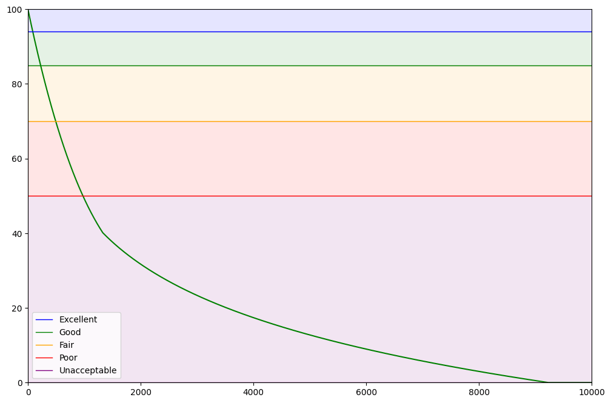

Performances
============

Transaction performances are evaluated based on response time (Time to Last Byte or TTLB), which is converted into a score from 0 to 100
(higher is better). We call this rating TPDEX (Transaction Performance Index).

This score is then converted into a letter rating for display.

.. versionchanged:: 0.12

    The response time is the whole exchange, from the request reaching HARP to the last byte of the response body
    sent to the client. Response bodies are streamed, so a slow client or a long download counts in the transaction's
    duration and lowers its TPDEX. Before 0.12 it stopped once HARP had read the upstream's body, before sending it.

   Response time (TTLB) to Transaction Performance Index (TPDEX)

* **Y Axis**: TPDEX
* **X Axis**: TTLB in milliseconds

Letter Rating
:::::::::::::

+----------------------+-------------------------+---------------------+
| TPDEX threshold      | Response time threshold | Rating              |
+======================+=========================+=====================+
| 98                   | 25ms                    | A++                 |
+----------------------+-------------------------+---------------------+
| 96                   | 50ms                    | A+                  |
+----------------------+-------------------------+---------------------+
| 93                   | 100ms                   | A                   |
+----------------------+-------------------------+---------------------+
| 83                   | 250ms                   | B                   |
+----------------------+-------------------------+---------------------+
| 69                   | 500ms                   | C                   |
+----------------------+-------------------------+---------------------+
| 49                   | 1s                      | D                   |
+----------------------+-------------------------+---------------------+
| 31                   | 2s                      | E                   |
+----------------------+-------------------------+---------------------+
| 17                   | 4s                      | F                   |
+----------------------+-------------------------+---------------------+
| 0                    | ∞                       | G                   |
+----------------------+-+-----------------------+---------------------+
