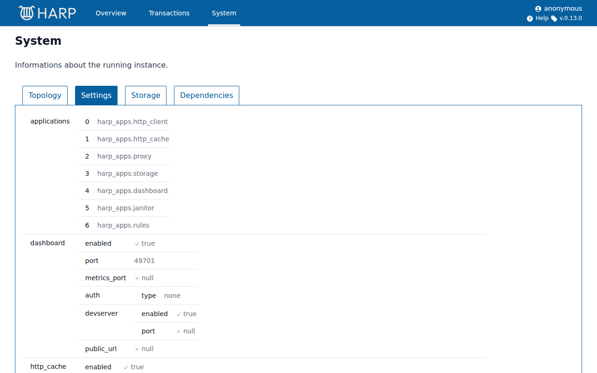
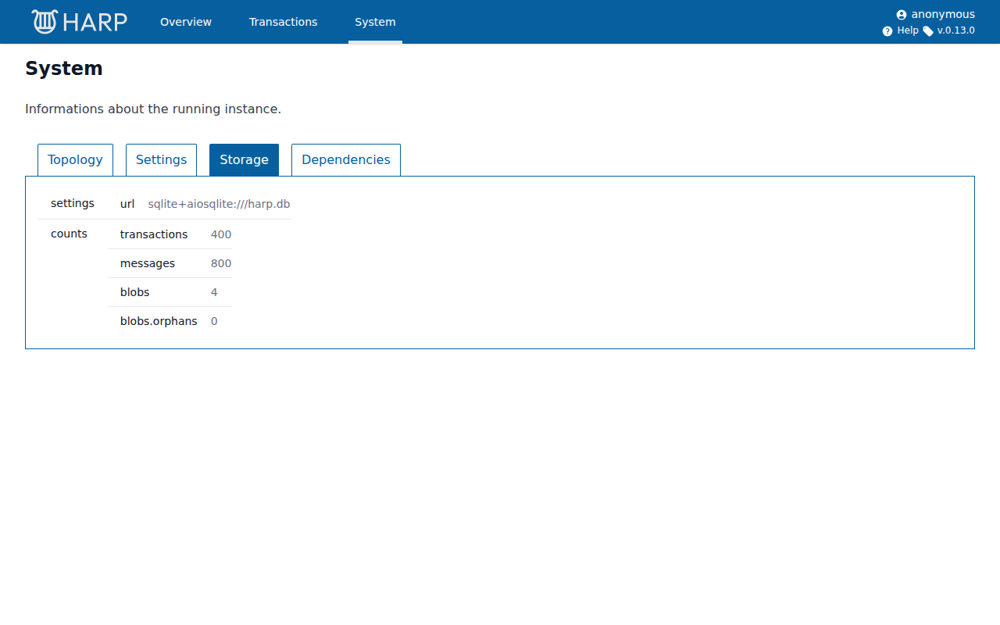
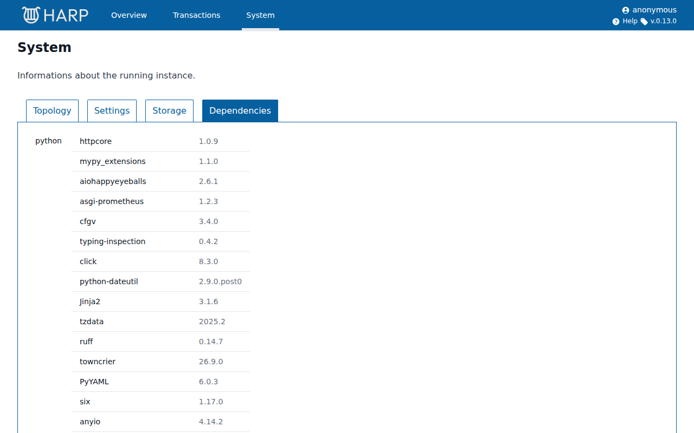

System
======

The «System» tab shows various informations about the currently running instance. It will help operators and developers
to understand how the running instance is configured.

You probably don't need those informations unless you know what you are looking for.

Settings
::::::::

The system settings tab (default) shows the current configuration.

Secrets are masked (``***``) in this tab, in ``GET /api/system/settings``, in ``harp-proxy system config`` and in
``harp-proxy system services``. A setting is masked because of its type, not its name:

- notification webhook URLs (``notifications.slack_webhook_url``, ``notifications.google_chat_webhook_url``), the Sentry
  ``dsn``, the values of the ``proxy.endpoints[].remote.probe.headers`` and the passwords of the dashboard users are
  masked entirely;
- in any URL, the password of every host of the authority (``user:password@host``), the username of an HTTP(S) URL
  that has no password (it is sent as the Basic auth username, so it often is a token) and the query parameters that
  usually carry a secret (``password``, ``key``, ``api_key``, ``token``, ``access_token``, ``secret``, ``auth``,
  ``signature``...) are masked.

Passing ``--unsecure`` to ``harp-proxy system config`` shows everything. A secret that lives in a free-form string
setting, outside of those rules, can not be recognized: this is the reason why the output deserves a glance before it
goes into a public bug report.

Storage
:::::::

The storage tab shows detailed informations about the current storage, including some usage metrics.

Dependencies
::::::::::::

The dependencies tab shows the installed python dependencies.

